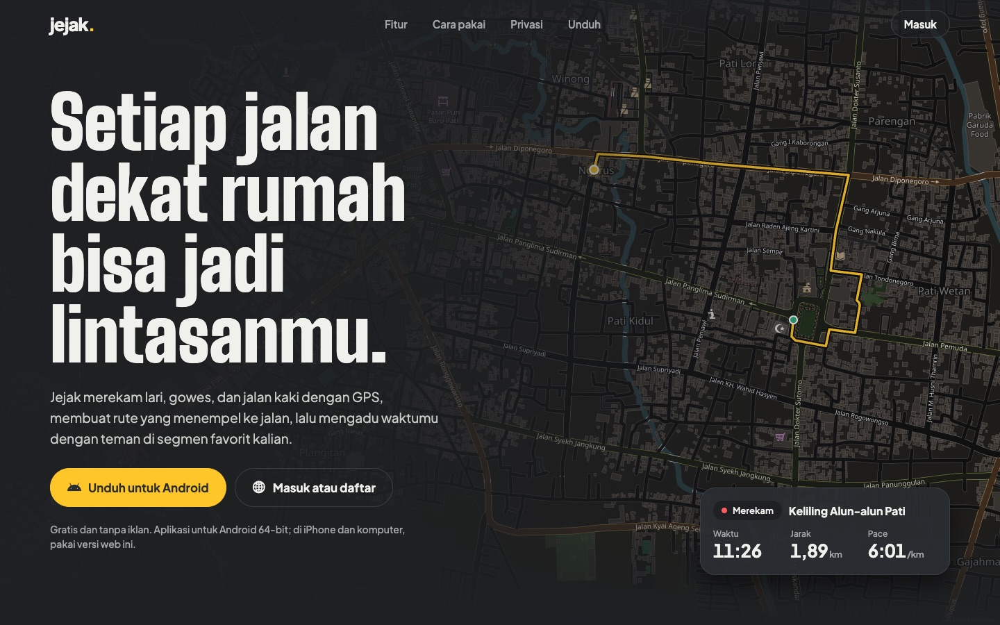
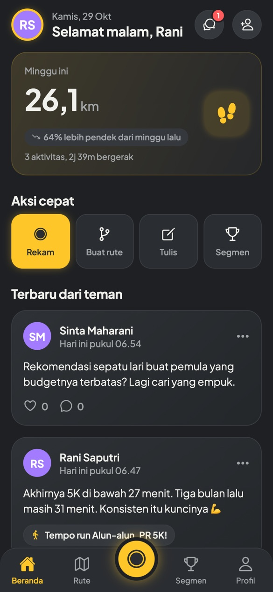
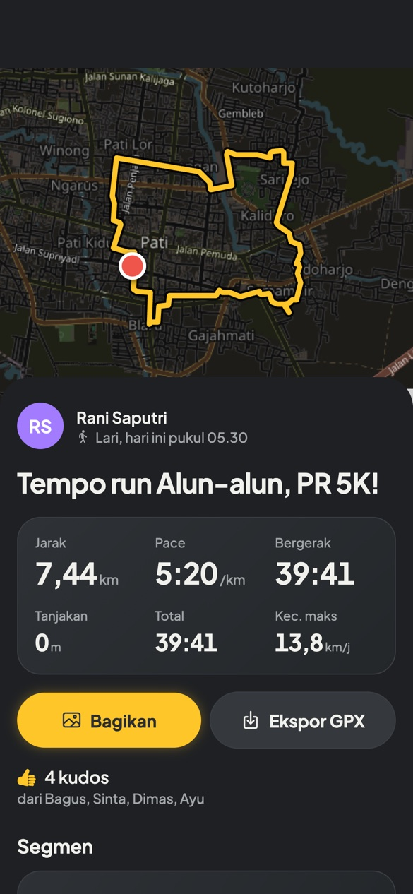
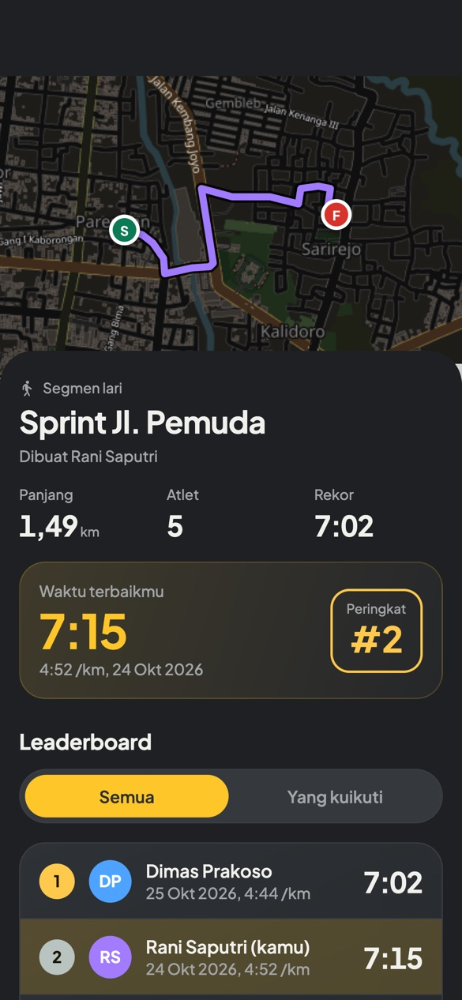
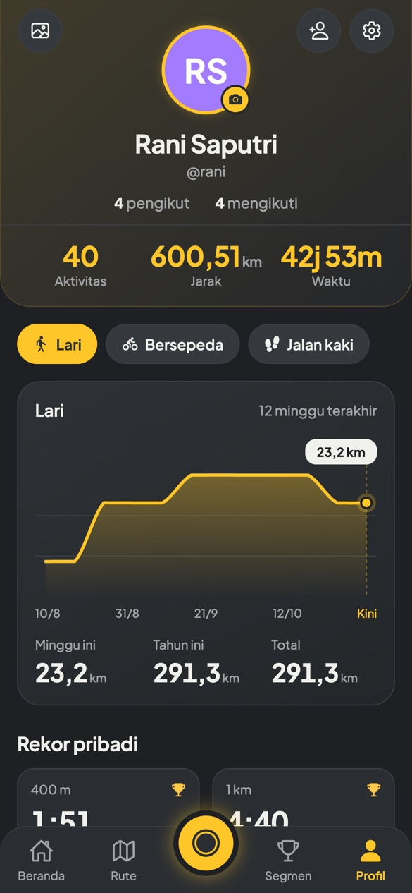
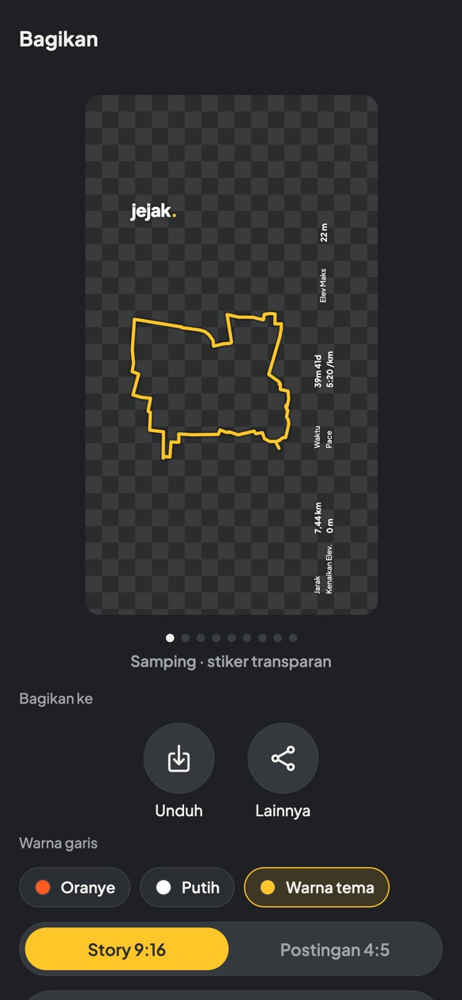
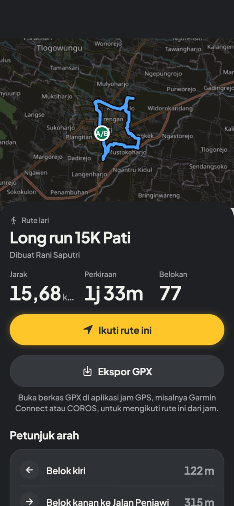

# Jejak

Aplikasi olahraga untuk lari, gowes, dan jalan kaki: rekam dengan GPS, buat rute sendiri yang menempel ke jalan lalu ikuti saat merekam, adu waktu di segmen bersama teman, serta berbagi lewat postingan, pesan, dan stiker foto. Gratis, tanpa iklan. Versi app saat ini: **0.3.1**.

**[Buka versi web](https://jejak.masamune.my.id)** · **[Unduh APK Android](https://jejak.masamune.my.id/unduh/jejak.apk)** · **[Dokumentasi](docs/README.md)**



| Beranda | Detail aktivitas | Segmen & leaderboard |
| :---: | :---: | :---: |
|  |  |  |
| **Profil & statistik** | **Bagikan ke foto** | **Rute & petunjuk arah** |
|  |  |  |

<sub>Tangkapan layar dari versi web di ukuran layar HP, dengan akun dan data contoh di sekitar Pati.</sub>

## Fitur

- **Rekam aktivitas**: lari, bersepeda, jalan kaki. Ada stopwatch, jarak, pace/kecepatan, jeda/lanjut, dan rekaman yang tetap aman walau app tertutup atau layar mati.
- **Buat rute sendiri**: ketuk titik-titik di peta, rute otomatis mengikuti jalan (OpenStreetMap/OSRM), lengkap dengan petunjuk belok berbahasa Indonesia. Ada tombol batal, pulang-pergi, dan kembali ke titik awal.
- **Ikuti rute**: saat merekam muncul banner belokan berikutnya ("Belok kiri ke Jalan Pemuda · dalam 120 m"), sisa jarak, dan peringatan *keluar dari rute*. HP bergetar saat mendekati belokan atau keluar jalur.
- **Riwayat & statistik**: split per km, waktu terbaik (400 m, 1 km, 5 km, 10 km, setengah maraton, maraton; sepeda 5–100 km), PR, grafik 12 minggu, total tahun ini dan sepanjang masa.
- **Segmen & leaderboard**: buat segmen dari potongan aktivitasmu. Semua aktivitas lama dan baru yang melewatinya otomatis dicocokkan. Leaderboard bisa "Semua" atau "Yang kuikuti", dengan medali PR.
- **Akun & teman**: daftar/masuk, ganti nama dan kata sandi, cari dan ikuti teman, daftar pengikut dan yang diikuti, feed aktivitas dan postingan, kudos, komentar.
- **Postingan & Diskusi segmen**: tulis postingan pendek (teks dan sampai 4 foto), suka, balas, laporkan. Postingan yang menandai segmen muncul di bagian Diskusi halaman segmen.
- **Pesan**: chat 1-lawan-1 dengan teman yang saling mengikuti, status terkirim/dibaca, blokir.
- **Bagikan ke foto**: 5 stiker transparan (Samping, Daftar, Tumpuk, Ringkas, Baris) untuk ditempel di atas foto Story, plus 4 template berlatar (Nomor dada, Rute, Patok KM, Rambu).
- **Ekspor GPX**: aktivitas dan rute bisa diekspor ke aplikasi lain atau jam GPS.
- **Foto profil & sampul**: dari galeri atau kamera, dipotong dan diperkecil di HP. Data lokasi GPS di foto dibuang sebelum disimpan.
- **Privasi**: awal dan akhir jejak disembunyikan dari orang lain, supaya alamat rumah tidak terlihat.
- **Notifikasi & pembaruan** (APK): pengumuman dan info versi baru lewat notifikasi push, kartu pembaruan di Beranda.
- **Tema**: gelap, terang, atau ikuti HP, dengan 5 warna aksen.

Rincian per layar ada di [docs/fitur.md](docs/fitur.md).

## Struktur

```
jejak/
├── app/      Aplikasi HP (Expo SDK 58 + Expo Router, React Native). Juga jalan di browser.
├── server/   API (Node 24 + Hono + SQLite bawaan Node). Tanpa langkah build.
├── shared/   Kode bersama app & server: hitungan geo (jarak, split, rekor,
│             pencocokan segmen, progres di rute) dan tipe data API.
├── deploy/   Skrip deploy, config nginx, dan service systemd.
└── docs/     Dokumentasi.
```

Versi produksi: **https://jejak.masamune.my.id** (web; pengunjung yang belum masuk melihat halaman depan dengan tombol unduh APK) dengan API di `https://jejak.masamune.my.id/api`.

## Menjalankan untuk pengembangan

Butuh Node 24 ke atas. Untuk mencoba di HP, pasang **Expo Go** dari Play Store/App Store.

```bash
npm run setup
```

Aplikasi (scan QR dengan Expo Go). Secara bawaan app memakai server produksi (`app/.env`):

```bash
npm run app
```

Untuk memakai server di komputer sendiri, buat `app/.env.local` berisi `EXPO_PUBLIC_API_URL=lan`, lalu jalankan server di terminal lain (port 4000, database di `server/data/jejak.db`; HP harus satu WiFi):

```bash
npm run server
```

Jangan jalankan Expo dengan `CI=1`, karena mode itu mematikan pemantauan file sehingga perubahan kode tidak terbaca. Versi browser bisa dibuka dengan `npm run web`.

### Mode uji (simulasi GPS)

Selama mode pengembangan, layar Rekam punya sakelar **Simulasi GPS**. Posisi bergerak sendiri di sepanjang rute yang dipilih (atau berputar di sekitar posisimu) dengan kecepatan 8×, jadi perekaman, pemandu rute, dan segmen bisa dicoba tanpa keluar rumah.

## Build APK (Android)

APK dibuat di cloud EAS dengan akun Expo, tanpa Android Studio. APK mandiri bisa merekam saat layar mati (lokasi latar) dan memakai server produksi. Peta di APK Android memakai **MapLibre** dengan ubin OpenStreetMap: gratis, tanpa kunci Google dan tanpa akun penagihan. Di Expo Go peta tetap memakai react-native-maps, karena Expo Go tidak membawa MapLibre.

Jalankan di folder `app` (login sekali saja):

```bash
cd app
npx eas-cli@latest login
npx eas-cli@latest init
npx eas-cli@latest build --platform android --profile preview
```

Saat pertama kali, pilih *Generate a new Android Keystore*. Setelah selesai, EAS memberi tautan/QR untuk mengunduh APK ke HP. Profil `production` membuat AAB untuk Google Play (`--profile production`).

Versi yang menambah modul native (0.2.0, 0.3.0) butuh APK baru; app tidak memakai pembaruan OTA. Detailnya di [docs/build-apk.md](docs/build-apk.md).

## Deploy server & web

Server produksi menjalankan API sebagai service systemd `jejak` dengan user non-root, di belakang nginx dan Cloudflare. Database dan folder foto `uploads/` wajib ikut backup. Alamat SSH server tidak ada di repo; atur sekali dengan `git config jejak.deployHost user@alamat-server` (atau variabel `JEJAK_HOST`). Setelah commit:

```bash
deploy/deploy.sh
```

Skrip ini mengirim commit `HEAD` ke server lewat SSH (`git archive`), menjalankan `npm ci`, memasang config nginx dan service systemd, lalu menjalankan ulang API; setelah itu membangun versi web dan mengunggahnya. Pakai `deploy/deploy.sh server` atau `deploy/deploy.sh web` untuk salah satunya saja. Detailnya di [docs/deploy.md](docs/deploy.md).

## Cek kode

```bash
npm run check
```

Perintah ini menjalankan typecheck server, tes server (`node --test`: geo, akun, feed, kudos, rute, segmen, leaderboard, foto, pengikut, postingan, chat, notifikasi), typecheck app, dan ESLint.

## Catatan

- Rute mengikuti jalan memakai server OSRM publik dari FOSSGIS (`routing.openstreetmap.de`, profil jalan kaki dan sepeda). Pakailah sewajarnya. Bila layanan gagal, rute otomatis jadi garis lurus. Server sendiri bisa dipakai lewat variabel `ROUTING_URL`.
- Semua peta memakai ubin OpenStreetMap (tanpa kunci API, wajib atribusi), yang digelapkan di tema gelap dan tampil asli di tema terang. Peta © [OpenStreetMap contributors](https://www.openstreetmap.org/copyright).
- Pertanyaan dan masukan: info@masamune.my.id.
