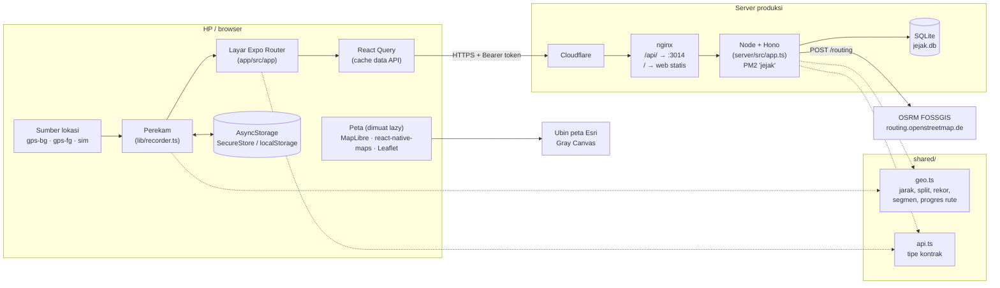

# Dokumentasi Jejak

Jejak adalah aplikasi olahraga ala Strava: rekam lari, bersepeda, dan jalan kaki dengan GPS, buat rute sendiri yang mengikuti jalan lalu ikuti saat merekam (petunjuk belok + peringatan keluar rute), lihat feed teman, beri kudos dan komentar, pantau statistik dan rekor pribadi, adu waktu di segmen lewat leaderboard, serta bagikan hasil aktivitas sebagai gambar atau berkas GPX.

Versi produksi: **https://jejak.masamune.my.id** (web) dengan API di `https://jejak.masamune.my.id/api`.

## Daftar dokumen

| Dokumen | Isi |
| --- | --- |
| [fitur.md](fitur.md) | Panduan pengguna per layar: daftar/masuk, beranda, rekam, ikuti rute, buat rute, detail aktivitas, bagikan ke foto, ekspor GPX, segmen, leaderboard, profil, cari teman. |
| [arsitektur.md](arsitektur.md) | Komponen dan aliran data, mesin status perekam, sumber lokasi, pemilihan dan pemuatan peta, pencatat crash, berbagi gambar/berkas, alamat API, token login, kunci React Query. |
| [api.md](api.md) | Referensi semua endpoint HTTP: metode, path, body, respons, kode error. |
| [data.md](data.md) | Skema SQLite: tabel, kolom, relasi, indeks, format kolom JSON. |
| [algoritma.md](algoritma.md) | Rumus dan ambang: waktu bergerak, tanjakan, kecepatan maksimum, split, waktu terbaik, PR, pencocokan segmen, progres rute, filter GPS, routing OSRM. |
| [pengembangan.md](pengembangan.md) | Setup lokal, variabel lingkungan, menjalankan server/app/web, simulasi GPS, tes, gaya kode, jebakan yang diketahui. |
| [deploy.md](deploy.md) | Server produksi, PM2, nginx + Cloudflare, `deploy/deploy.sh`, log, backup, rollback. |
| [build-apk.md](build-apk.md) | Membuat dan memasang APK/AAB lewat EAS, ukuran APK (arm64), keystore, peta MapLibre, lokasi latar, izin foto/kamera, log crash dengan adb, menaikkan versi. |
| [troubleshooting.md](troubleshooting.md) | Masalah umum dan cara mengatasinya, termasuk APK yang tertutup sendiri dan gambar yang tidak tersimpan. |
| [desain.md](desain.md) | Riset UI/UX dan sistem desain: kosakata visual dari jalan (aspal, marka, patok, rambu), warna, huruf, template bagikan. |
| [ide-fitur.md](ide-fitur.md) | Daftar fitur yang sudah ada dan ide fitur berikutnya, dengan perkiraan usaha dan perlu-tidaknya build baru. |

Dokumentasi di atas ditulis berdasarkan kode pada commit `f42d7fa`. Bila perilaku app atau server berubah, perbarui dokumen yang bersangkutan.

## Gambaran singkat

Repo ini berisi tiga bagian yang saling terkait:

```
jejak/
├── app/      Aplikasi Expo SDK 58 + Expo Router (React Native 0.88, React 19).
│             Jalan di Android, iOS, dan browser (web).
├── server/   API Node 24+ dengan Hono dan SQLite bawaan Node (node:sqlite).
│             TypeScript dijalankan langsung, tanpa langkah build.
├── shared/   Kode bersama app & server: hitungan geo (geo.ts) dan tipe kontrak API (api.ts).
└── deploy/   Skrip deploy, konfigurasi PM2, dan konfigurasi nginx produksi.
```

Prinsip penting:

- **Hitungan geo hanya ada di satu tempat** (`shared/geo.ts`). Server memakainya untuk ringkasan aktivitas, split, waktu terbaik, dan pencocokan segmen; app memakainya untuk jarak, simulasi GPS, dan pemandu rute. Perubahan di sana langsung berlaku untuk keduanya.
- **Ringkasan aktivitas dihitung server.** App hanya mengirim titik-titik GPS mentah (`track`); jarak, waktu bergerak, tanjakan, split, waktu terbaik, PR, dan waktu segmen semuanya dihitung ulang di server saat aktivitas diunggah.
- **Perekaman tahan app tertutup.** Status perekam disimpan ke penyimpanan lokal secara berkala dan dipulihkan saat app dibuka lagi.

## Diagram arsitektur



Garis putus-putus berarti "memakai kode dari". Saat pengembangan lokal, app bisa langsung memanggil server di komputer sendiri (`http://<ip-komputer>:4000`) tanpa Cloudflare dan nginx. Lihat [pengembangan.md](pengembangan.md).
