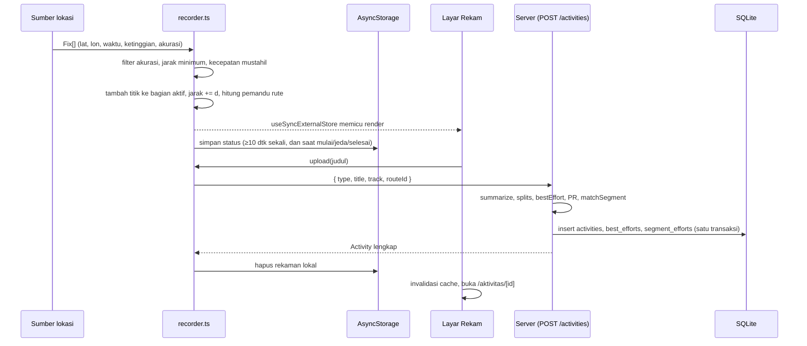
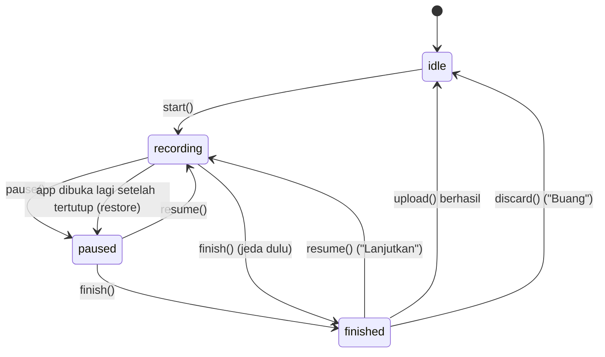

# Arsitektur

Dokumen ini menjelaskan bagaimana bagian-bagian Jejak saling terhubung: dari titik GPS di HP sampai baris di database.

## Daftar isi

1. [Komponen](#komponen)
2. [Aliran data utama](#aliran-data-utama)
3. [Perekam (state machine)](#perekam-state-machine)
4. [Sumber lokasi](#sumber-lokasi)
5. [Pemandu rute](#pemandu-rute)
6. [Pemilihan implementasi peta](#pemilihan-implementasi-peta)
7. [Pencatat crash dan ErrorBoundary](#pencatat-crash-dan-errorboundary)
8. [Berbagi gambar dan berkas](#berbagi-gambar-dan-berkas)
9. [Alamat server API](#alamat-server-api)
10. [Login dan token](#login-dan-token)
11. [React Query](#react-query)
12. [Server](#server)

---

## Komponen

### App (`app/`)

| Bagian | Lokasi | Peran |
| --- | --- | --- |
| Layar | `src/app/` | Expo Router berbasis berkas. `_layout.tsx` memasang pencatat crash, React Query, `AuthProvider`, font, `ErrorBoundary`, dan `Stack` dengan `Stack.Protected` (layar utama hanya untuk yang sudah masuk; `masuk` hanya untuk yang belum). Tab ada di `(tabs)/`. |
| Komponen | `src/components/` | UI bersama (`ui.tsx`), kartu aktivitas, profil, grafik, tab bar, peta, banner petunjuk arah (`GuideBanner.tsx`), template bagikan (`ShareTemplates.tsx`), dan layar laporan error (`CrashReport.tsx`). |
| Perekam | `src/lib/recorder.ts` | Mesin status perekaman, filter titik GPS, stopwatch, penyimpanan lokal, pemandu rute. |
| Lokasi | `src/lib/gps.ts`, `location-task.ts`, `sim.ts`, `location-source.ts` | Sumber posisi: GPS latar, GPS layar menyala, atau simulasi. |
| API | `src/lib/api.ts` | Alamat server, `fetch` dengan token dan batas waktu, pesan error. |
| Login | `src/lib/auth.tsx`, `storage.ts`, `storage.web.ts` | Konteks pengguna, simpan/hapus token. |
| Berbagi | `src/lib/share-file.ts`, `share-file.web.ts`, `gpx.ts`, `route-path.ts` | Membagikan/menyimpan gambar dan berkas, membuat GPX, memproyeksikan garis rute ke kanvas template. |
| Crash | `src/lib/crash.ts` | Mencatat error JavaScript fatal untuk ditampilkan saat app dibuka lagi. |
| Format | `src/lib/format.ts` | Jarak, durasi, pace, kecepatan, tanggal, kalimat meta (*Lari, hari ini pukul 06.12*), judul bawaan. |
| Tema | `src/lib/theme.ts` | Warna dari jalan (`ROAD`: aspal, beton, marka, patok, rambu) untuk tema terang/gelap, font (Plus Jakarta Sans untuk teks, Big Shoulders Display untuk angka), jarak, sudut. Lihat [desain.md](desain.md). |

### Server (`server/`)

| Berkas | Peran |
| --- | --- |
| `src/index.ts` | Membaca `PORT`, `HOST`, `DB_PATH`, membuka database, menjalankan Hono lewat `@hono/node-server`. |
| `src/app.ts` | `createApp(db)`: semua endpoint, validasi input, perhitungan saat aktivitas/segmen disimpan. |
| `src/db.ts` | Skema SQLite, pragma, migrasi tabel sesi lama, helper transaksi `tx()`. |
| `src/routing.ts` | Permintaan ke OSRM FOSSGIS dan teks belok bahasa Indonesia. |
| `src/auth.ts` | Hash kata sandi (scrypt), token acak, dan hash token untuk tabel sesi. |

### Kode bersama (`shared/`)

| Berkas | Peran |
| --- | --- |
| `geo.ts` | Semua hitungan geografis. Sengaja tanpa `import` supaya bisa dipakai Metro (app) dan Node (server) apa adanya. |
| `api.ts` | Tipe kontrak data API. Hanya `import type`, tanpa kode. |

App mengimpor lewat alias `@shared/*` (lihat `app/tsconfig.json`), server lewat path relatif `../../shared/*.ts`.

---

## Aliran data utama

### Merekam sampai tersimpan



Penting: app **tidak** mengirim jarak atau waktu hasil hitungannya sendiri. Server menghitung ulang semuanya dari `track` memakai `shared/geo.ts`, jadi angka di detail aktivitas bisa sedikit berbeda dari angka di layar rekam (misalnya Pace di layar rekam memakai waktu aktif, sedangkan detail memakai waktu bergerak).

### Membuat rute

Layar `rute/baru` mengirim `POST /routing` setiap titik berubah (ditunda 350 ms). Server meminta rute ke OSRM dan mengembalikan `geometry`, `distanceM`, `steps`, dan `snapped`. Saat disimpan (`POST /routes`), app mengirim `waypoints`, `geometry`, dan `steps` hasil perencanaan; server menghitung ulang jarak dan cuplikan dari `geometry`.

### Membuat segmen

Layar `aktivitas/[id]/segmen` mengirim indeks awal/akhir pada titik track yang sudah diratakan. Server memotong track, menyederhanakan garisnya, lalu mencocokkan **semua** aktivitas lama yang relevan dalam satu transaksi. Lihat [algoritma.md](algoritma.md#pencocokan-segmen).

---

## Perekam (state machine)

State perekam hidup **di luar React** (variabel modul di `recorder.ts`), supaya rekaman tetap berjalan saat pengguna pindah layar. Komponen membacanya lewat `useRecorder()` (`useSyncExternalStore`).



### Isi state (`RecState`)

| Field | Arti |
| --- | --- |
| `status` | `idle`, `recording`, `paused`, atau `finished`. |
| `type` | `run`, `ride`, atau `walk`. Hanya bisa diubah saat `idle`. |
| `route` | Rute yang diikuti (`PlannedRoute`) atau `null`. Hanya bisa diubah saat `idle`. |
| `parts` | Track dalam bagian-bagian (`TrackPoint[][]`). `start()` membuat satu bagian kosong, setiap `resume()` menambah bagian baru. |
| `distanceM` | Jarak terekam (hanya di dalam bagian, perpindahan saat jeda tidak dihitung). |
| `activeMs` | Waktu aktif yang terkumpul sebelum bagian yang sedang berjalan. |
| `runningSince` | Jam sumber lokasi saat bagian sekarang mulai, `null` saat jeda. |
| `here`, `accuracy` | Posisi dan akurasi terakhir (diperbarui juga saat titiknya ditolak filter). |
| `sourceKind` | `gps-bg`, `gps-fg`, `sim`, atau `null`. |
| `guide` | Hasil pemandu rute (lihat [Pemandu rute](#pemandu-rute)). |

Stopwatch = `activeMs + (now − runningSince)`, dengan `now` dari jam sumber lokasi (`source.now()`). Simulasi punya jam sendiri yang berjalan 8× lebih cepat. Layar Rekam memperbarui stopwatch tiap 250 ms selama `recording`.

### Transisi

| Aksi | Syarat | Yang terjadi |
| --- | --- | --- |
| `start(makeSource)` | `idle` | Buat sumber lokasi, reset progres rute, `parts = [[]]`, `status = recording`, mulai sumber, simpan. Bila sumber **gagal mulai**, sumber dibuang dan status kembali `idle` (track dikosongkan), lalu error diteruskan ke layar. |
| `pause()` | `recording` | Hentikan sumber, tambahkan waktu bagian ini ke `activeMs`, `status = paused`, simpan. Sumber **tidak** dibuang, jadi `resume()` memakainya lagi. |
| `resume(makeSource)` | `paused` atau `finished` | Buat sumber baru bila sudah dibuang, tambah bagian kosong, `status = recording`, mulai sumber. Bila sumber **gagal mulai**, sumber dibuang dan `status` serta `parts` dikembalikan seperti sebelum `resume()`, lalu error diteruskan ke layar. |
| `finish()` | apa pun | Bila masih `recording`, jeda dulu. Hentikan dan buang sumber, `status = finished`, simpan. |
| `discard()` | apa pun | Hentikan sumber, reset ke `idle` (jenis dan posisi terakhir dipertahankan), hapus simpanan. |
| `upload(title)` | biasanya `finished` | Kirim bagian yang tidak kosong ke `POST /activities` (batas waktu 60 dtk). Bila berhasil, panggil `discard()`. Bila gagal, state tidak berubah. |
| `restore()` | dipanggil sekali saat app dibuka | Lihat di bawah. |

### Penyimpanan ke AsyncStorage

Kunci `jejak.rekaman` berisi JSON `{ status, type, route, parts, distanceM, activeMs }` (`activeMs` sudah termasuk bagian yang sedang berjalan saat disimpan). Penyimpanan terjadi:

- saat `start`, `pause`, `finish`, dan `discard` (pada `idle` kuncinya dihapus);
- setiap perubahan state selama `recording`, paling sering sekali per 10 detik (`SAVE_EVERY_MS`).

### Pemulihan setelah app tertutup

`app/src/app/_layout.tsx` memanggil `recorder.restore()` sekali saat app dimulai:

1. Baca `jejak.rekaman`. Bila kosong, selesai.
2. Muat ulang state dengan `runningSince = null`.
3. Bila status tersimpan `recording`:
   - ambil titik dari **buffer lokasi latar** (`drainBackgroundBuffer()`) dan masukkan lewat filter yang sama;
   - hentikan layanan lokasi latar yang mungkin masih jalan;
   - ubah status menjadi `paused`.
4. Bila JSON rusak, simpanan dihapus.

Akibatnya, rekaman yang terputus selalu muncul sebagai **Dijeda**. Waktu selama app mati tidak masuk stopwatch, tetapi titik-titik dari buffer latar tetap masuk ke track (sehingga ikut dihitung server).

### Buffer lokasi latar

`location-task.ts` mendaftarkan tugas `jejak-rekam-lokasi` lewat `TaskManager.defineTask` **di level modul**, dan berkas ini di-import di baris paling atas `_layout.tsx` (tepat setelah `@/lib/crash`) supaya tugas sudah terdaftar sebelum navigasi berjalan. Saat tugas menerima lokasi:

- bila perekam sedang hidup (`listener` terpasang), titik langsung diteruskan ke perekam;
- bila tidak (app ditutup, hanya layanan latar yang jalan), titik ditambahkan ke AsyncStorage dengan kunci `jejak.bgbuffer`, untuk diambil `restore()` nanti.

Di web, `location-task.web.ts` menggantikan modul ini: lokasi latar selalu tidak tersedia.

---

## Sumber lokasi

Antarmuka `LocationSource` (`location-source.ts`): `kind`, `start(onFix)`, `stop()`, `now()`. Setiap pembacaan berbentuk `Fix { lat, lon, t, alt, acc }`.

| `kind` | Dibuat oleh | Kapan dipakai | Cara kerja |
| --- | --- | --- | --- |
| `gps-bg` | `createGpsSource()` | Lokasi latar tersedia (build sendiri, bukan Expo Go) **dan** izin latar diberikan. | `Location.startLocationUpdatesAsync` dengan layanan latar depan (notifikasi *Jejak sedang merekam*). Tetap merekam saat layar mati. |
| `gps-fg` | `createGpsSource()` | Selain kondisi di atas (Expo Go, izin latar ditolak, web). | `Location.watchPositionAsync` plus `expo-keep-awake` supaya layar tidak mati. |
| `sim` | `createSimSource()` | Sakelar Simulasi GPS aktif (hanya `__DEV__`). | Timer yang menggeser posisi di sepanjang garis, jam sendiri 8× lebih cepat. |

Pengaturan GPS untuk kedua jenis GPS asli: akurasi `BestForNavigation`, interval 1000 ms, jarak minimum 2 m. `gps-bg` juga memakai `activityType: Fitness` dan `pausesUpdatesAutomatically: false`.

Alur izin di `createGpsSource()`:

1. Minta izin lokasi saat dipakai. Bila ditolak: error *Izin lokasi ditolak. Aktifkan lokasi untuk Jejak di pengaturan HP.*
2. Bila lokasi latar tersedia (`TaskManager.isAvailableAsync()` dan `Location.isBackgroundLocationAvailableAsync()`), cek izin latar. Bila belum diberikan, masih bisa ditanyakan, dan **belum pernah** ditanyakan (penanda `jejak.izinLatarDitanya` di AsyncStorage), minta sekali.
3. Bila izin latar ada, pakai `gps-bg`; bila tidak, pakai `gps-fg`.

Sumber dibuat saat `start()`, dan saat `resume()` bila sumber sebelumnya sudah dibuang oleh `finish()` atau oleh app yang tertutup. Jadi mengubah izin di tengah rekaman baru berpengaruh setelah sumber dibuat ulang.

---

## Pemandu rute

Setiap kali posisi berubah (juga saat `idle` lewat `setHere()`), perekam memanggil `computeGuide()`:

1. `progressOnRoute()` memproyeksikan posisi ke garis rute, dengan progres sebelumnya (`routeAlong`) sebagai acuan supaya tidak meloncat mundur.
2. `remainingM = total − alongM`.
3. Petunjuk berikutnya = langkah pertama dengan `atM > alongM − 5`. Jaraknya `inM = atM − alongM` (minimal 0).
4. `offRoute = offM > 40` (`OFF_ROUTE_M`).
5. Hanya saat `recording`: getar peringatan saat **mulai** keluar rute, dan getar kuat sekali per petunjuk saat `inM < 30`.

Progres rute direset ke 0 saat rute diganti dan saat `start()`. Rumus `progressOnRoute` dijelaskan di [algoritma.md](algoritma.md#progres-di-rute).

---

## Pemilihan implementasi peta

Semua peta menerima props yang sama (`MapProps` di `components/map-types.ts`): `lines`, `pins`, `me`, `fit`, `followMe`, `initialCenter`, `onPress`, `interactive`, `bottomInset`.

| Platform | Berkas | Mesin peta | Ubin |
| --- | --- | --- | --- |
| Web | `Map.web.tsx` (dipilih otomatis lewat ekstensi `.web`) | Leaflet | OpenStreetMap, digelapkan dengan filter CSS pada lapisan ubin |
| Android, build sendiri (APK/AAB, development build) | `LibreMap.tsx` | MapLibre (`@maplibre/maplibre-react-native`) | OpenStreetMap yang sama, raster digelapkan lewat cat raster |
| Android di Expo Go | `NativeMap.tsx` | react-native-maps (Google Maps bawaan Expo Go) | Gaya Google dengan POI dan transit disembunyikan |
| iOS (Expo Go maupun build) | `NativeMap.tsx` | react-native-maps (Apple Maps, `mutedStandard`) | Apple |

Pemilihnya di `components/Map.tsx`:

```ts
const WANT_LIBRE = Platform.OS === 'android' && Constants.executionEnvironment !== ExecutionEnvironment.StoreClient;
```

`StoreClient` berarti Expo Go. Cara memuatnya:

1. **Dimuat saat dibutuhkan (lazy).** `JejakMap` membungkus implementasi dengan `React.lazy` + `Suspense`. Modul peta baru di-`require` saat peta pertama kali tampil, bukan saat app dibuka, sehingga masalah di modul peta tidak menghentikan app sejak awal (misalnya layar masuk tetap bisa dibuka). Selama memuat, tempat peta diisi `View` kosong dengan ukuran yang sama.
2. **Cadangan ke react-native-maps.** Bila `WANT_LIBRE` benar tetapi `require('./LibreMap')` melempar error, app mencatat `[peta] MapLibre gagal dimuat, pakai react-native-maps: …` di konsol lalu memakai `NativeMap`. Sejak `edea652` react-native-maps tidak lagi dipasang di APK Android (`app/react-native.config.js`), jadi di sana cadangan ini hanya menampilkan tempat peta kosong, tetapi app tidak tertutup.
3. Implementasi yang terpilih disimpan dan dipakai ulang untuk semua peta berikutnya. Modul yang tidak terpilih tidak pernah di-`require`, sehingga Expo Go tidak menyentuh kode native MapLibre (yang memang tidak dibawa Expo Go).

Cadangan ini hanya menangkap kegagalan **memuat modul JavaScript**. Crash di dalam kode native MapLibre setelah peta tampil tidak bisa ditangkap dari JavaScript (lihat [Pencatat crash](#pencatat-crash-dan-errorboundary)).

Alasan MapLibre di APK Android: react-native-maps di Android memakai Google Maps SDK yang butuh kunci API Google (dan akun penagihan). MapLibre dengan ubin OpenStreetMap gratis dan tanpa kunci. react-native-maps juga membawa WorkManager, yang membuat APK tertutup saat dibuka setelah kodenya diacak R8; karena itu react-native-maps dikeluarkan dari build Android (lihat [build-apk.md](build-apk.md#bila-apk-tertutup-sendiri-crash)).

Tabel di atas berlaku bila MapLibre berhasil dimuat; bila gagal, Android build sendiri juga jatuh ke `NativeMap.tsx` (lihat cadangan di bawah). Lihat juga [build-apk.md](build-apk.md#peta-di-apk-android-maplibre).

Ubin OpenStreetMap tersedia sampai zoom 19 dan digelapkan di sisi app (lihat [desain.md](desain.md#peta)). Atribusi *© OpenStreetMap* wajib ditampilkan, dan permintaan ubin dari HP membawa User-Agent `Jejak/1.0` sesuai kebijakan ubin OSM. Alamat dan header ubin ada di `app/src/lib/tiles.ts`.

**Cuplikan peta** (`StaticMap.tsx`) bukan peta interaktif: komponen ini memilih zoom tertinggi (maksimal 17) yang memuat seluruh garis dengan padding 28 px, menaruh ubin OpenStreetMap sebagai gambar yang digelapkan dengan filter (`expo-image`, cache memori + disk), lalu menggambar garis dan titik awal/akhir dengan SVG. Dipakai di feed, daftar rute, daftar segmen, pemilih rute, dan layar simpan. Cuplikan hanya digambar bila ada minimal 2 titik.

---

## Pencatat crash dan ErrorBoundary

Di APK (build rilis) tidak ada layar merah seperti saat pengembangan: error JavaScript fatal langsung menutup app tanpa petunjuk. Dua mekanisme menangani ini.

### 1. Error saat menampilkan layar: `ErrorBoundary`

`app/src/app/_layout.tsx` mengekspor `ErrorBoundary` (fitur Expo Router). Bila sebuah layar melempar error saat dirender, Expo Router menampilkan `CrashReportView` berjudul **Ada yang gagal di layar ini** berisi pesan error, 14 baris pertama stack, dan waktu kejadian, dengan tombol **Coba lagi** (memanggil `retry()`). App tidak tertutup.

### 2. Error fatal di luar render: `lib/crash.ts`

`@/lib/crash` di-import **paling awal** di `_layout.tsx`. Saat dimuat, modul ini memasang handler global lewat `ErrorUtils.setGlobalHandler`:

1. Error yang **tidak fatal** diteruskan ke handler bawaan tanpa diubah.
2. Error **fatal** diubah menjadi laporan `{ message, stack (14 baris), at }` dan disimpan ke AsyncStorage dengan kunci `jejak.crash`. Setelah penyimpanan selesai (berhasil atau gagal), barulah handler bawaan dipanggil, dan handler itulah yang menutup app.
3. Saat app dibuka lagi, `Root` di `_layout.tsx` memanggil `takeLastCrash()` (bersamaan dengan `recorder.restore()`). Fungsi ini membaca laporan lalu **langsung menghapusnya**, jadi laporan hanya tampil sekali.
4. Bila ada laporan, setelah font dan login siap, app menampilkan `CrashReportView` berjudul **Jejak sempat berhenti** dengan tombol **Tutup**. Setelah ditutup, app berjalan normal.

`CrashReportView` (`components/CrashReport.tsx`) berlatar gelap dan mengajak pengguna memotret layar lalu mengirimkannya ke pengembang.

### Yang tidak tertangkap

Crash **native** (Java/Kotlin/C++), misalnya modul native yang tidak ada di build, crash di dalam MapLibre, atau kehabisan memori, tidak melewati handler JavaScript. App tertutup tanpa laporan, dan penyebabnya hanya bisa dilihat dengan `adb logcat` (lihat [build-apk.md](build-apk.md#bila-apk-tertutup-sendiri-crash)).

---

## Berbagi gambar dan berkas

Fitur **Bagikan ke foto** dan **Ekspor GPX** memakai modul dengan dua versi; Metro memilih berdasarkan ekstensi platform.

| Fungsi | `share-file.ts` (HP) | `share-file.web.ts` (web) |
| --- | --- | --- |
| `shareTextFile(nama, mime, isi)` (GPX) | Tulis ke `Paths.cache` dengan `expo-file-system` (hapus dulu bila sudah ada), lalu `Sharing.shareAsync` dengan judul *Ekspor aktivitas*. | `Blob` + tautan `<a download>` sementara; URL objek dicabut setelah 10 detik. |
| `shareImage(uri)` | Cek `Sharing.isAvailableAsync()` (bila tidak: *Berbagi tidak tersedia di perangkat ini*), lalu `Sharing.shareAsync` dengan `image/png`. | `navigator.share({ files })` bila `navigator.canShare` mengizinkan berkas; selain itu unduh `jejak.png`. |
| `saveImage(uri, nama)` | `MediaLibrary.requestPermissionsAsync(true, ['photo'])` (hanya menulis, izin foto). Bila ditolak: *Izin galeri ditolak…*. Lalu `MediaLibrary.Asset.create(uri)`. | Unduh dengan nama `nama`. |
| `CAPTURE_RESULT` | `'tmpfile'`: hasil tangkapan berupa berkas sementara. | `'data-uri'`: hasil tangkapan berupa data URI. |

Alur layar Bagikan (`aktivitas/[id]/bagikan.tsx`):

1. Data aktivitas diambil dengan kunci React Query `['activity', id]` (sama dengan layar detail, jadi biasanya langsung dari cache).
2. Kanvas pratinjau = foto (`expo-image`, `contentFit="cover"`) atau `PlainBackground`, ditimpa template dari `ShareTemplates.tsx`. Ukuran pratinjau = lebar terkecil dari (lebar layar − 32), (55% tinggi layar × rasio), dan 440 px. Semua ukuran di template diskalakan dari lebar kanvas (desain dasar 360 px).
3. `captureRef` dari `react-native-view-shot` menangkap kanvas sebagai PNG dengan lebar keluaran 1080 px fisik (`1080 / PixelRatio.get()` titik), tinggi sesuai rasio 4:5 atau 9:16.
4. Hasilnya diteruskan ke `shareImage` atau `saveImage`.

`route-path.ts` memproyeksikan `preview` aktivitas (Web Mercator) ke dalam kotak w × h dengan padding, proporsional dan di tengah, lalu menghasilkan atribut `d` untuk `<Path>` SVG beserta titik awal dan akhir. Dipakai template *Rute* dan latar polos.

Ekspor GPX: `gpx.ts` membangun teks GPX 1.1 dari `Activity` (lihat [fitur.md](fitur.md#ekspor-gpx)), lalu `shareTextFile(gpxFileName(a), 'application/gpx+xml', …)`.

---

## Alamat server API

`app/src/lib/api.ts`, fungsi `resolveApiUrl()`, dihitung sekali saat app dimuat:

1. Bila `EXPO_PUBLIC_API_URL` terisi dan **bukan** `lan`: pakai nilai itu (garis miring di akhir dibuang).
2. Bila kosong atau `lan`:
   - di web: `<protokol halaman>//<hostname halaman>:4000`;
   - di HP: `http://<host Metro>:4000`, dengan host diambil dari `Constants.expoConfig.hostUri` (alamat komputer yang menjalankan `expo start`, otomatis diketahui Expo Go). Bila tidak ada, `http://localhost:4000`.

Sumber nilai:

| Berkas | Isi | Catatan |
| --- | --- | --- |
| `app/.env` | `EXPO_PUBLIC_API_URL=https://jejak.masamune.my.id/api` | Ikut di git. Bawaan untuk dev, build EAS, dan web. |
| `app/.env.local` | misalnya `EXPO_PUBLIC_API_URL=lan` | Diabaikan git (`.env*.local`). Menimpa `.env` saat dev lokal. |
| `deploy/deploy.sh` | `EXPO_PUBLIC_API_URL=https://jejak.masamune.my.id/api` | Dipasang eksplisit saat `expo export` versi web. |

Variabel `EXPO_PUBLIC_*` ditanam ke bundel JavaScript saat bundling, jadi setelah mengubahnya, Metro perlu dijalankan ulang.

Perilaku `api()`:

- header `Content-Type: application/json` dan `Authorization: Bearer <token>` bila sudah masuk;
- metode bawaan `GET`, atau `POST` bila ada `body`;
- batas waktu 20 detik (unggah aktivitas 60 detik);
- gagal jaringan/batas waktu: `ApiError(0, "Tidak bisa terhubung ke server (<URL>). Pastikan server jalan dan HP satu WiFi dengan komputer.")`;
- respons bukan 2xx: `ApiError(status, body.error)` atau `Permintaan gagal (<status>)` bila badan bukan JSON;
- **401 saat punya token**: memanggil handler yang mengeluarkan pengguna (token, data pengguna, dan cache dihapus), sehingga app kembali ke layar masuk.

---

## Login dan token

`app/src/lib/auth.tsx`:

- `AuthProvider` membaca kunci `jejak.auth` saat mulai. Isinya JSON `AuthResult` (`{ token, user }`). Selama membaca, `ready = false` dan splash screen tetap tampil.
- Penyimpanan: `storage.ts` memakai **expo-secure-store** (Keychain iOS / Keystore Android); `storage.web.ts` memakai **localStorage** (bila tidak tersedia, token hanya di memori).
- `signIn(r)`: pasang token ke modul API, simpan pengguna, tulis ke penyimpanan.
- `signOut()`: `POST /logout` (error diabaikan), lalu hapus token, pengguna, cache React Query, dan kunci penyimpanan.
- `useMe()` mengembalikan pengguna aktif (atau pengguna kosong sesaat ketika keluar).

Di server, token adalah 32 byte acak (base64url). Tabel `sessions` hanya menyimpan hash SHA-256-nya, dan sesi kedaluwarsa bila 90 hari tidak dipakai. Lihat [api.md](api.md#autentikasi).

---

## React Query

`QueryClient` di `_layout.tsx`: `retry: 1`, `staleTime: 15_000` (15 detik). Banyak layar juga memanggil `useRefetchOnFocus()` (`lib/hooks.ts`), yang mengambil ulang data setiap layar kembali difokuskan (tidak termasuk pertama kali dibuka).

| Kunci | Endpoint | Dipakai di |
| --- | --- | --- |
| `['feed']` | `GET /feed` (infinite, `before`) | Beranda |
| `['stats', userId, type]` | `GET /users/:id/stats?type=…&tz=…` | Beranda (`type = 'all'`), Profil |
| `['user', userId]` | `GET /users/:id` | Profil |
| `['userActivities', userId]` | `GET /users/:id/activities` (infinite) | Profil |
| `['activity', id]` | `GET /activities/:id` | Detail aktivitas, Buat segmen, Bagikan |
| `['comments', activityId]` | `GET /activities/:id/comments` | Detail aktivitas |
| `['routes']` | `GET /routes` | Tab Rute, pemilih rute di Rekam |
| `['route', id]` | `GET /routes/:id` | Detail rute, parameter `?rute=` di Rekam |
| `['segments', 'lat,lon' \| '']` | `GET /segments?near=…` | Tab Segmen |
| `['segment', id, filter]` | `GET /segments/:id[?filter=following]` | Detail segmen |
| `['users', query]` | `GET /users?q=…` | Cari teman |

Invalidasi setelah perubahan:

| Aksi | Kunci yang diinvalidasi |
| --- | --- |
| Simpan aktivitas, hapus aktivitas | `feed`, `userActivities`, `stats`, `user` |
| Kudos | `feed`, `['activity', id]`, `userActivities` |
| Kirim/hapus komentar | `['comments', id]`, `feed` |
| Ikuti dari Cari | `users`, `feed`, `user` |
| Ikuti dari Profil | `['user', id]` diisi langsung dari respons, `feed` diinvalidasi |
| Simpan/hapus rute | `routes` |
| Buat segmen | `['activity', id]`, `segments` |
| Hapus segmen | `segments` |
| Keluar / 401 | seluruh cache dibersihkan (`queryClient.clear()`) |

Infinite query feed dan aktivitas profil memakai `startedAt` aktivitas terakhir sebagai `before` untuk halaman berikutnya, dan berhenti bila satu halaman berisi kurang dari 20 item.

---

## Server

- **Hono** dengan `cors()` untuk semua origin, sehingga versi web di domain lain (atau `localhost` saat dev) bisa memanggil API.
- **Middleware login** dipasang setelah `/health`, `/auth/register`, dan `/auth/login`. Semua path lain wajib `Authorization: Bearer <token>`; permintaan `OPTIONS` dilewatkan.
- **Error**: `fail(status, pesan)` melempar `HTTPException`; `onError` mengubahnya menjadi `{ "error": "<pesan>" }`. Error tak terduga dicatat ke konsol dan dibalas 500 *Terjadi kesalahan di server*.
- **Database**: satu koneksi `DatabaseSync` (`node:sqlite`) dengan WAL, foreign key aktif, dan `busy_timeout` 5000 ms. Penyimpanan aktivitas dan pembuatan segmen memakai transaksi (`tx()`).
- **Routing**: `createApp(db, { planRoute })` bisa menerima `planRoute` tiruan; tes memakainya supaya tidak memanggil OSRM.

Detail endpoint ada di [api.md](api.md), skema di [data.md](data.md).
