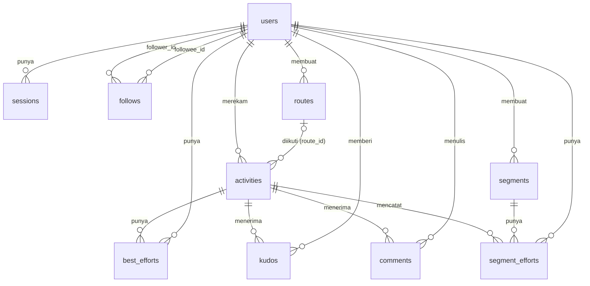

# Skema data (SQLite)

Database adalah satu berkas SQLite yang dibuka lewat `node:sqlite` (`DatabaseSync`). Skema ada di `server/src/db.ts` dan dibuat otomatis saat server mulai (`create table if not exists`).

## Daftar isi

1. [Lokasi dan pengaturan](#lokasi-dan-pengaturan)
2. [Diagram relasi](#diagram-relasi)
3. [Tabel](#tabel)
4. [Indeks](#indeks)
5. [Format kolom JSON](#format-kolom-json)
6. [Perubahan skema](#perubahan-skema)

---

## Lokasi dan pengaturan

| Lingkungan | Berkas |
| --- | --- |
| Lokal (bawaan) | `server/data/jejak.db` (folder dibuat otomatis, diabaikan git) |
| Produksi | `/var/www/jejak.masamune.my.id/data/jejak.db` (lewat `DB_PATH` di `deploy/jejak.service`; folder milik user `jejak`, izin 700) |
| Tes | `:memory:` |

Pragma yang dipasang setiap kali database dibuka:

| Pragma | Nilai | Akibat |
| --- | --- | --- |
| `journal_mode` | `wal` | Ada berkas pendamping `jejak.db-wal` dan `jejak.db-shm`. Ketiganya satu kesatuan. |
| `foreign_keys` | `on` | `on delete cascade` / `set null` benar-benar dijalankan. |
| `busy_timeout` | `5000` | Menunggu kunci sampai 5 detik sebelum gagal. |

Semua kolom waktu bawaan (`created_at`) diisi `strftime('%Y-%m-%dT%H:%M:%fZ', 'now')`, yaitu ISO 8601 UTC dengan milidetik, misalnya `2026-10-28T06:12:03.512Z`. Kolom `started_at` diisi dari waktu titik GPS pertama dengan format yang sama (`Date.toISOString()`), sehingga perbandingan string (`<`, `order by`) sama dengan urutan waktu.

---

## Diagram relasi



---

## Tabel

### `users`

| Kolom | Tipe | Keterangan |
| --- | --- | --- |
| `id` | integer PK | |
| `username` | text, not null, **unique collate nocase** | Disimpan huruf kecil oleh API. |
| `name` | text, not null | Nama tampilan. |
| `password_hash` | text, not null | Format `scrypt$<salt hex 16 byte>$<hash hex 32 byte>`. |
| `created_at` | text, not null | Waktu daftar. |

### `sessions`

| Kolom | Tipe | Keterangan |
| --- | --- | --- |
| `token_hash` | text PK | SHA-256 (hex) dari token. Token mentah (32 byte acak, base64url) tidak disimpan. |
| `user_id` | integer → `users.id` | `on delete cascade`. |
| `created_at` | text | Waktu sesi dibuat. |
| `last_used_at` | text | Terakhir dipakai, diperbarui paling sering sekali sehari. Sesi yang 90 hari tidak dipakai ditolak dan dihapus. |

Database dari sebelum kolom `token_hash` (kolom lama `token` berisi token mentah) dimigrasi otomatis oleh `openDb()`: tabel dibuat ulang dengan token yang di-hash dalam satu transaksi, tanpa mengeluarkan pengguna.

### `follows`

| Kolom | Tipe | Keterangan |
| --- | --- | --- |
| `follower_id` | integer → `users.id` | Yang mengikuti. Cascade. |
| `followee_id` | integer → `users.id` | Yang diikuti. Cascade. |
| `created_at` | text | |

Primary key `(follower_id, followee_id)`.

### `routes`

| Kolom | Tipe | Keterangan |
| --- | --- | --- |
| `id` | integer PK | |
| `user_id` | integer → `users.id` | Pembuat. Cascade. |
| `name` | text | 1–80 karakter. |
| `type` | text | `run`, `ride`, `walk`. |
| `distance_m` | real | Panjang `geometry`, dihitung server. |
| `waypoints` | text (JSON) | Titik yang diketuk pengguna. |
| `geometry` | text (JSON) | Garis rute lengkap. |
| `steps` | text (JSON) | Petunjuk belok. |
| `preview` | text (JSON) | Garis ringkas untuk cuplikan. |
| `created_at` | text | |

### `activities`

| Kolom | Tipe | Keterangan |
| --- | --- | --- |
| `id` | integer PK | |
| `user_id` | integer → `users.id` | Pemilik. Cascade. |
| `type` | text | `run`, `ride`, `walk`. |
| `title` | text | 1–100 karakter. |
| `started_at` | text | Waktu titik pertama (ISO UTC). Dipakai urutan feed, paginasi, dan statistik. |
| `elapsed_s` | real | Titik pertama sampai terakhir, termasuk jeda. |
| `moving_s` | real | Waktu bergerak. |
| `distance_m` | real | Jarak tanpa perpindahan antar bagian. |
| `elev_gain_m` | real | Total tanjakan. |
| `max_speed_mps` | real | Kecepatan maksimum (jendela ≥5 detik). |
| `min_lat`, `max_lat`, `min_lon`, `max_lon` | real | Kotak batas track, untuk saringan awal pencocokan segmen. |
| `preview` | text (JSON) | Garis ringkas maksimal 80 titik. |
| `track` | text (JSON) | Track lengkap. Bisa beberapa MB untuk aktivitas panjang. |
| `splits` | text (JSON) | Split per km. |
| `pr_count` | integer, bawaan 0 | Jumlah PR waktu terbaik + PR segmen saat diunggah. |
| `route_id` | integer → `routes.id`, boleh null | `on delete set null`. |
| `created_at` | text | Waktu diunggah. |

Semua angka ringkasan dihitung server dari `track` saat `POST /activities`. Lihat [algoritma.md](algoritma.md).

### `best_efforts`

Satu baris per jarak standar yang tercapai dalam satu aktivitas.

| Kolom | Tipe | Keterangan |
| --- | --- | --- |
| `activity_id` | integer → `activities.id` | Cascade. |
| `user_id` | integer → `users.id` | Cascade. Diduplikasi dari aktivitas supaya kueri rekor cepat. |
| `type` | text | Jenis aktivitas. |
| `name` | text | Misalnya `400 m`, `1 km`, `Setengah maraton`, `100 km`. |
| `distance_m` | real | Jarak standar. |
| `elapsed_s` | real | Waktu tercepat untuk jarak itu dalam aktivitas ini. |
| `is_pr` | integer 0/1 | 1 bila lebih cepat dari waktu terbaik sebelumnya (jenis + nama yang sama) saat diunggah. |

Primary key `(activity_id, name)`.

### `kudos`

| Kolom | Tipe | Keterangan |
| --- | --- | --- |
| `activity_id` | integer → `activities.id` | Cascade. |
| `user_id` | integer → `users.id` | Pemberi. Cascade. |
| `created_at` | text | |

Primary key `(activity_id, user_id)`: satu orang satu kudos per aktivitas.

### `comments`

| Kolom | Tipe | Keterangan |
| --- | --- | --- |
| `id` | integer PK | |
| `activity_id` | integer → `activities.id` | Cascade. |
| `user_id` | integer → `users.id` | Penulis. Cascade. |
| `body` | text | 1–500 karakter. |
| `created_at` | text | |

### `segments`

| Kolom | Tipe | Keterangan |
| --- | --- | --- |
| `id` | integer PK | |
| `user_id` | integer → `users.id` | Pembuat. Cascade. |
| `name` | text | 1–80 karakter. |
| `type` | text | `run` (berlaku untuk lari dan jalan kaki) atau `ride`. |
| `distance_m` | real | Panjang potongan track asli (sebelum disederhanakan). |
| `geometry` | text (JSON) | Garis segmen setelah disederhanakan (toleransi 2 m). |
| `preview` | text (JSON) | Garis ringkas maksimal 80 titik. |
| `min_lat`, `max_lat`, `min_lon`, `max_lon` | real | Kotak batas `geometry`. |
| `created_at` | text | |

### `segment_efforts`

Satu baris per (segmen, aktivitas) yang cocok.

| Kolom | Tipe | Keterangan |
| --- | --- | --- |
| `id` | integer PK | |
| `segment_id` | integer → `segments.id` | Cascade. |
| `activity_id` | integer → `activities.id` | Cascade. |
| `user_id` | integer → `users.id` | Cascade. |
| `elapsed_s` | real | Waktu aktif dari titik awal sampai titik akhir yang cocok. |
| `distance_m` | real | Jarak track di antara keduanya. |
| `start_index`, `end_index` | integer | Indeks pada track yang sudah diratakan. |
| `is_pr` | integer 0/1 | Lebih cepat dari waktu terbaik atlet itu sebelumnya di segmen ini. |
| `started_at` | text | Salinan `activities.started_at`, untuk tanggal di leaderboard. |

Unique `(segment_id, activity_id)`: satu aktivitas paling banyak satu waktu per segmen (yang tercepat bila dilewati berkali-kali).

### Akibat penghapusan

| Yang dihapus | Ikut terhapus / berubah |
| --- | --- |
| Pengguna | Semua sesi, follow, rute, aktivitas, segmen, kudos, komentar, waktu terbaik, dan waktu segmennya (tidak ada endpoint untuk ini). |
| Aktivitas | `best_efforts`, `kudos`, `comments`, `segment_efforts` aktivitas itu. |
| Rute | `activities.route_id` menjadi `NULL`. |
| Segmen | Semua `segment_efforts` segmen itu. |

Status `is_pr` dan `pr_count` di baris lain tidak dihitung ulang setelah penghapusan.

---

## Indeks

| Indeks | Kolom | Untuk |
| --- | --- | --- |
| `activities_user` | `activities(user_id, started_at desc)` | Feed, daftar aktivitas pengguna, statistik. |
| `best_efforts_user` | `best_efforts(user_id, type, name, elapsed_s)` | Mencari rekor sebelumnya dan daftar rekor. |
| `comments_activity` | `comments(activity_id, created_at)` | Daftar komentar per aktivitas. |
| `segment_efforts_board` | `segment_efforts(segment_id, elapsed_s)` | Leaderboard dan peringkat. |

Ditambah indeks otomatis dari primary key dan unique: `users.username`, `sessions.token_hash`, `follows(follower_id, followee_id)`, `kudos(activity_id, user_id)`, `best_efforts(activity_id, name)`, `segment_efforts(segment_id, activity_id)`.

Kolom kotak batas (`min_lat` … `max_lon`) tidak diindeks; pencarian segmen dan aktivitas di sekitar sebuah kotak memindai tabel. Untuk skala kecil ini cukup.

---

## Format kolom JSON

Semua kolom JSON disimpan sebagai teks hasil `JSON.stringify`. Koordinat selalu `[lintang, bujur]` (bukan `[bujur, lintang]` seperti GeoJSON).

### `activities.track`

`TrackPoint[][]`: array bagian, tiap bagian array titik. Bagian baru dimulai setiap kali rekaman dilanjutkan setelah jeda.

```json
[
  [
    [-7.8139, 110.9258, 1761630723000, 112.3],
    [-7.81385, 110.92581, 1761630724000, 112.4]
  ],
  [
    [-7.812, 110.926, 1761631000000, null]
  ]
]
```

| Posisi | Isi |
| --- | --- |
| 0 | Lintang (derajat). |
| 1 | Bujur (derajat). |
| 2 | Waktu epoch dalam **milidetik**. Tidak mundur di dalam satu bagian. |
| 3 | Ketinggian GPS (meter, dibulatkan 0,1 m oleh app) atau `null`. |

"Track yang diratakan" (dipakai `start_index`/`end_index` dan `startIndex`/`endIndex` di API) = semua bagian disambung berurutan (`geo.flatten`).

### `activities.preview`, `routes.preview`, `segments.preview`

`LatLon[]` hasil penyederhanaan Douglas-Peucker, **maksimal 80 titik**, dibulatkan 6 desimal (sekitar 0,1 m).

```json
[[-7.8139, 110.9258], [-7.8031, 110.9258], [-7.8031, 110.933]]
```

### `activities.splits`

`Split[]`, satu per kilometer:

```json
[
  { "index": 1, "distanceM": 1000, "elapsedS": 331.8 },
  { "index": 2, "distanceM": 1000, "elapsedS": 335.2 },
  { "index": 3, "distanceM": 412.6, "elapsedS": 140.1 }
]
```

Split terakhir bisa lebih pendek dari 1000 m; sisa kurang dari 50 m dibuang (kecuali itu satu-satunya split).

### `routes.waypoints`

`LatLon[]`, 2–50 titik yang diketuk pengguna, urut.

### `routes.geometry` dan `segments.geometry`

`LatLon[]`. Untuk rute: garis dari OSRM (atau garis lurus antar waypoint), 2–20.000 titik. Untuk segmen: potongan track yang disederhanakan dengan toleransi 2 m.

### `routes.steps`

`RouteStep[]`, urut dari awal rute:

```json
[
  { "atM": 412.5, "text": "Belok kiri ke Jalan Pemuda", "at": [-7.8102, 110.9261] },
  { "atM": 2010.0, "text": "Sampai di tujuan", "at": [-7.8031, 110.933] }
]
```

| Field | Isi |
| --- | --- |
| `atM` | Jarak dari awal rute (m) sampai titik belok, diukur di sepanjang `geometry`. |
| `text` | Kalimat petunjuk (maksimal 120 karakter). |
| `at` | Lokasi titik belok. |

Rute garis lurus menyimpan `[]`.

---

## Perubahan skema

Tidak ada sistem migrasi. `create table if not exists` hanya membuat tabel yang belum ada; menambah kolom pada tabel yang sudah ada **tidak** terjadi otomatis. Bila skema berubah:

1. Tambahkan perubahan ke `SCHEMA` di `server/src/db.ts` (untuk database baru).
2. Untuk database yang sudah berjalan (produksi), jalankan `alter table …` secara manual atau tambahkan langkah migrasi di `openDb()`.
3. Backup database dulu (lihat [deploy.md](deploy.md#backup-database)).
